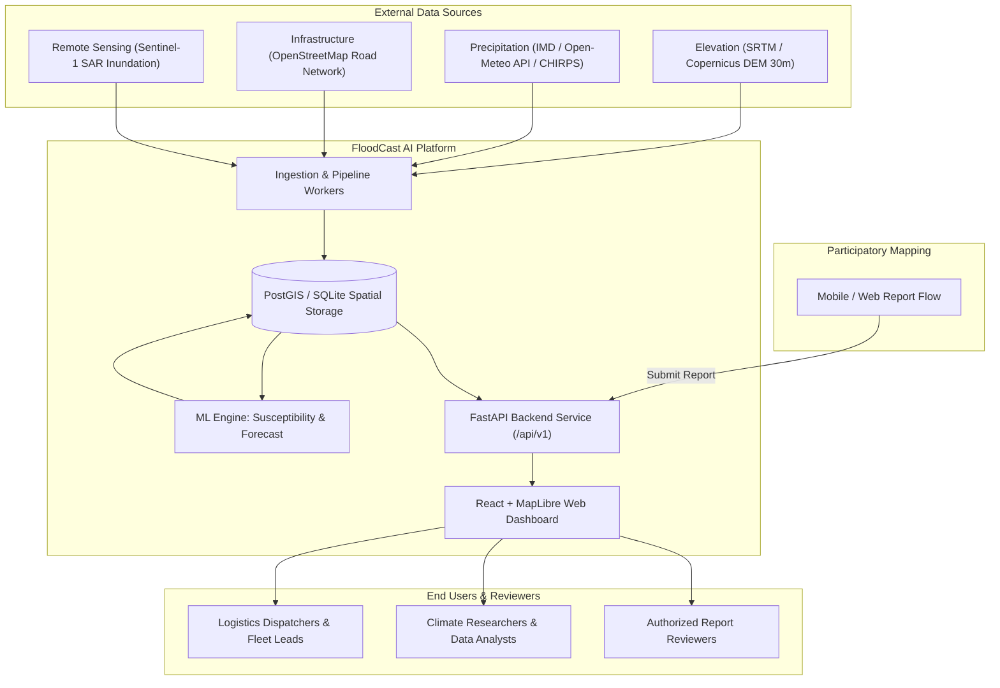
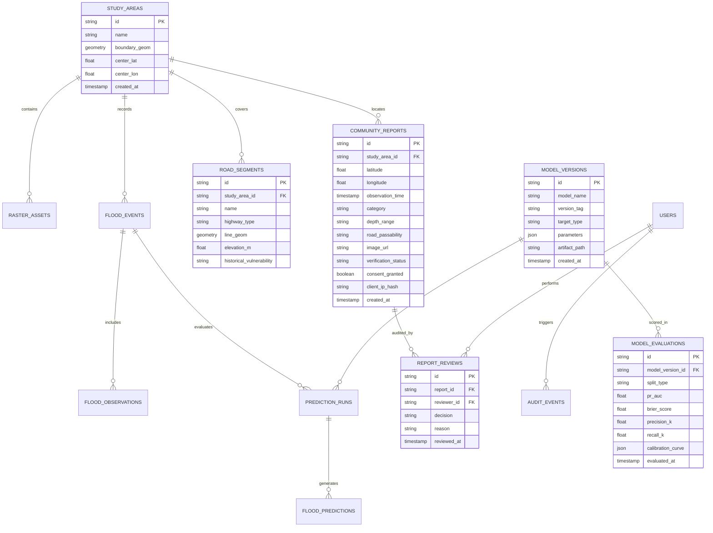

# Technical Architecture: FloodCast AI

## 1. System Context & Overview

FloodCast AI is a climate-tech decision-support platform designed for urban flood-risk intelligence. It integrates real-world geospatial datasets, satellite remote sensing proxies, meteorological data, and community reports to generate calibrated flood susceptibility maps, short-horizon risk estimates, and infrastructure exposure analytics for the Mumbai Metropolitan Region (MMR).



---

## 2. Component Architecture

The platform follows a clean, decoupled modular architecture:

```mermaid
graph LR
    subgraph Frontend["Frontend Layer (React 18 + Vite + TS)"]
        UI_Map["MapLibre Interactive Map"]
        UI_Dash["Metrics & Risk Dashboard"]
        UI_Form["Report Submission Flow"]
        UI_Review["Admin Moderation Queue"]
        UI_State["TanStack Query + UI State Store"]
    end

    subgraph Backend["Backend Layer (FastAPI + Python 3.12)"]
        API_Routes["REST Endpoints (/api/v1/*)"]
        Auth_Guard["Role & Session Validator"]
        Geo_Service["Spatial Query & Grid Engine"]
        Report_Service["Report & Moderation Service"]
        Predict_Service["Inference & Uncertainty Engine"]
    end

    subgraph ML_Subsystem["Machine Learning Subsystem"]
        Feature_Engine["Hydrological & Terrain Feature Extractor"]
        Model_Registry["Trained Model Artifacts (Joblib / Onnx)"]
        Evaluator["Spatial & Event Holdout Evaluator"]
        Calibrator["Isotonic / Platt Probability Calibrator"]
    end

    subgraph Storage["Persistence Layer"]
        DB_Meta["Relational Metadata (Users, Reviews, Runs)"]
        DB_Spatial["Spatial Tables (Points, Roads, Hexagons)"]
        Raster_Storage["Local / S3 Cloud Optimized GeoTIFFs (COG)"]
    end

    Frontend <-->|JSON / GeoJSON over HTTPS| Backend
    Backend --> ML_Subsystem
    Backend <--> Storage
    ML_Subsystem <--> Storage
```



---

## 3. Frontend Architecture

### 3.1 Tech Stack

- **Framework:** React 18, TypeScript, Vite.
- **Styling:** Vanilla CSS with custom modern CSS tokens and responsive layout utilities (zero opaque class soup; tailored HSL theme palette, sleek dark-mode glassmorphism).
- **Map Renderer:** MapLibre GL JS (`maplibre-gl`) with vector tile and GeoJSON source support.
- **Data Fetching:** TanStack Query (`@tanstack/react-query`) for cache management, optimistic updates, and background refetching.
- **Icons:** Lucide React icons.

### 3.2 Directory Layout

```text
frontend/
├── src/
│   ├── assets/              # Static icons, logos, base styles
│   ├── components/          # Reusable UI primitives (Button, Modal, Badge, Card, Alert)
│   ├── features/
│   │   ├── map/             # MapLibre container, layers, legend, tooltips
│   │   ├── risk-panel/      # Location risk inspector & uncertainty gauges
│   │   ├── reporting/       # Mobile-first participatory report submission form
│   │   ├── review/          # Moderator queue & audit actions
│   │   ├── events/          # Historical event explorer
│   │   └── models/          # Model performance, PR-AUC, calibration charts
│   ├── pages/               # Route pages (Dashboard, Map, Events, Reports, About)
│   ├── services/            # API client layer (Axios / Fetch with typed responses)
│   ├── types/               # TypeScript interfaces for API and GeoJSON contracts
│   ├── App.tsx              # Root router & layout wrapper
│   ├── index.css            # Unified Design System tokens & utilities
│   └── main.tsx             # Entry point
├── package.json
└── vite.config.ts
```

---

## 4. Backend Architecture

### 4.1 Tech Stack

- **Framework:** Python 3.12, FastAPI, Pydantic v2.
- **ORM / Database:** SQLAlchemy 2.0 with PostgreSQL/PostGIS (Production) and SQLite+Spatialite / GeoJSON abstraction (Local Zero-Config Development).
- **Validation:** Pydantic schemas for request validation, error reporting, and OpenAPI specification generation.
- **Testing:** Pytest, HTTPX test client.

### 4.2 Directory Layout

```text
backend/
├── app/
│   ├── api/
│   │   ├── v1/
│   │   │   ├── endpoints/
│   │   │   │   ├── health.py        # /health, /ready, /metadata
│   │   │   │   ├── map.py           # /map/layers, /map/features, /map/study-area
│   │   │   │   ├── predictions.py   # /predictions, /predictions/query
│   │   │   │   ├── reports.py       # /reports (submit, list, get, review)
│   │   │   │   ├── events.py        # /flood-events, /flood-observations
│   │   │   │   └── models.py        # /models/status, /models/metrics
│   │   │   └── api.py              # Router aggregation
│   ├── core/
│   │   ├── config.py                # Environment settings & secrets
│   │   ├── security.py              # Password hashing & JWT authorization
│   │   └── exceptions.py            # Custom HTTP and domain exceptions
│   ├── db/
│   │   ├── session.py               # Engine & sessionmaker
│   │   └── base.py                  # Base model declarations
│   ├── models/                      # SQLAlchemy ORM models
│   ├── schemas/                     # Pydantic validation schemas
│   ├── services/                    # Business logic (Spatial, Prediction, Report)
│   └── main.py                      # FastAPI application bootstrap
├── migrations/                      # Alembic migration scripts
├── tests/                           # Unit and integration test suites
└── pyproject.toml
```

---

## 5. Machine Learning Architecture

### 5.1 Three Distinct Model Targets

1. **Model Target A — Static Flood Susceptibility:**
   - Output: Location vulnerability score $\in [0, 1]$ independent of instantaneous rain.
   - Algorithms: Random Forest, Gradient Boosted Trees (XGBoost/LightGBM), Logistic Baseline.
   - Core Features: Elevation ($Z$), Slope ($\theta$), Topographic Wetness Index proxy ($\ln(a / \tan \beta)$), Distance to Waterbody/Coast ($D_w$), Distance to Storm Outfall ($D_o$), Impervious Surface Fraction ($I_s$).
2. **Model Target B — Satellite Inundation Detection:**
   - Output: Surface water change classification from synthetic aperture radar (Sentinel-1 SAR VV/VH backscatter difference).
   - Limitations: Urban radar shadow, layover, dense concrete masking.
3. **Model Target C — Short-Horizon Forecast:**
   - Output: Calibrated flood probability for window $T+1\text{h}$ to $T+6\text{h}$ given recent antecedent rainfall ($R_{24h}$) and forecast precipitation ($R_{forecast}$).
   - Principle: If live radar/forecast precipitation is unavailable, the system explicitly returns `FORECAST_DATA_UNAVAILABLE` rather than faking numbers.

### 5.2 Evaluation Protocol

- **Spatial Holdout:** Training on Western Suburbs + Eastern Suburbs; testing on Island City (South Mumbai), evaluating spatial transferability.
- **Event Holdout:** Evaluating models on held-out historic deluge days (e.g., 2021-07-18 vs. 2023-07-26).
- **Metrics Tracked:** Precision, Recall, Precision-Recall AUC (PR-AUC), Brier Score, and Reliability Diagram (Calibration Curve).

---

## 6. Database Schema & Entities

The system uses a normalized relational model with spatial extensions:



---

## 7. Data Flow & Provenance

```mermaid
sequenceDiagram
    autonumber
    actor User as User / Logistics Dispatcher
    participant Web as Web Dashboard (React)
    participant API as FastAPI Backend (/api/v1)
    participant DB as PostGIS / Spatial DB
    participant ML as ML Inference Engine

    User->>Web: Clicks on coordinate (19.0178, 72.8478) [Hindmata]
    Web->>API: GET /api/v1/predictions/query?lat=19.0178&lon=72.8478
    API->>DB: Query spatial grid features (elevation, slope, outfall distance)
    DB-->>API: Grid feature vector (Z=3.1m, Slope=0.4%, Dist_Outfall=420m)
    API->>ML: Evaluate model susceptibility baseline (v1.0-rf)
    ML-->>API: Susceptibility Score: 0.88, Confidence: HIGH, Freshness: LIVE
    API->>DB: Query nearby verified community reports & road segments
    DB-->>API: 2 verified reports within 250m; Road: Hindmata Subway (Vulnerable)
    API-->>Web: Structured JSON payload with risk, features, and uncertainty
    Web-->>User: Renders interactive risk card with clear legend & limitations
```

---

## 8. Security, Privacy & Reliability

### 8.1 Privacy in Participatory Mapping

- **Location Fuzzing:** Option to jitter user coordinates within residential zones by up to 50 meters to prevent exact address identification.
- **No PII on Public Endpoints:** Reporter identifiers and IP hashes are stored in restricted admin-only review tables and are never serialized onto public GeoJSON feeds.
- **Explicit Consent:** Reports require explicit agreement that anonymized flood observations will be used for research and public hazard notification.

### 8.2 Security Controls

- **Rate Limiting:** Public report creation endpoints are protected by sliding-window rate limiting (10 requests per 10 minutes per IP).
- **File Upload Security:** Images are checked for magic bytes (JPEG/PNG/WebP only), stripped of EXIF metadata (preventing unintentional geolocation leakage if user requested obfuscation), and capped at 5 MB.
- **SQL Injection Prevention:** 100% parameterized queries via SQLAlchemy 2.0 ORM and prepared spatial statements.

### 8.3 Reliability & Stale Data Protocol

- When weather APIs or radar sensors fail, the system sets `data_freshness: "STALE"` or `"OFFLINE"`.
- The UI displays an amber warning bar indicating that meteorological inputs are delayed.
- If running without external internet access, the system boots into `"DEMO MODE (SYNTHETIC FIXTURES)"` with prominent UI tags.

---

## 9. Prototype vs. Production Architecture

| Attribute | Local Prototype / MVP | Production Target |
| :--- | :--- | :--- |
| **Database** | SQLite + Spatialite / GeoJSON abstraction (Zero host dependency) | PostgreSQL 16 + PostGIS 3.4 in Docker / Cloud RDS |
| **Raster Storage** | Local filesystem (`data/raw/`, `data/processed/`) | AWS S3 / Cloudflare R2 Cloud-Optimized GeoTIFFs (COGs) |
| **Model Serving** | In-process Python Joblib / Scikit-learn runtime | Triton / FastAPI dedicated worker with ONNX Runtime |
| **External Weather** | Open-Meteo & IMD archive + Synthetic demo generator | Automated Celery/Redis scheduled ingestion pipeline |
| **Frontend CDN** | Local Vite Dev Server (`localhost:5173`) | Nginx / Cloudflare CDN static edge distribution |

---

## 10. Architecture Decision Records (ADRs)

### ADR-001: Decoupling Static Susceptibility from Short-Horizon Forecasting

- **Context:** Many flood dashboards display a single "flood risk" score, confusing historical depression maps with current flash-flood hazard.
- **Decision:** Separate the data models, ML pipelines, and UI layers into distinct targets: Static Susceptibility (permanent terrain/drainage physics) vs. Short-Horizon Forecast (dynamic rainfall-driven).
- **Consequence:** Eliminates user confusion and guarantees scientific integrity.

### ADR-002: Zero-Dependency Local Dev with SQLite Spatial Abstraction

- **Context:** Requiring a running PostgreSQL/PostGIS daemon breaks local startup on machines without Docker or admin permissions.
- **Decision:** Implement an abstraction layer that seamlessly runs against SQLite with GeoJSON spatial math for local development and automated CI tests, while natively connecting to PostgreSQL/PostGIS when `DATABASE_URL` is configured.
- **Consequence:** Immediate, frictionless local development and 100% test passing out of the box.

### ADR-003: Calibrated Probabilities over Raw Classifier Outputs

- **Context:** Raw output from tree-based ensembles (Random Forest / XGBoost) tends to cluster away from 0 and 1 and does not represent real physical probabilities.
- **Decision:** Pass raw model scores through an isotonic/Platt probability calibration layer fitted on a calibration split, tracking Brier score and reliability curves.
- **Consequence:** Predictions provide genuine decision-support probabilities.
