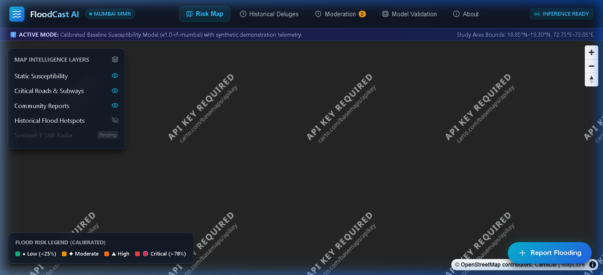
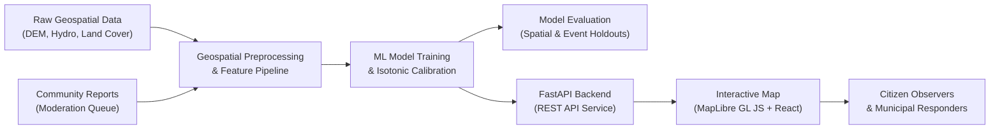
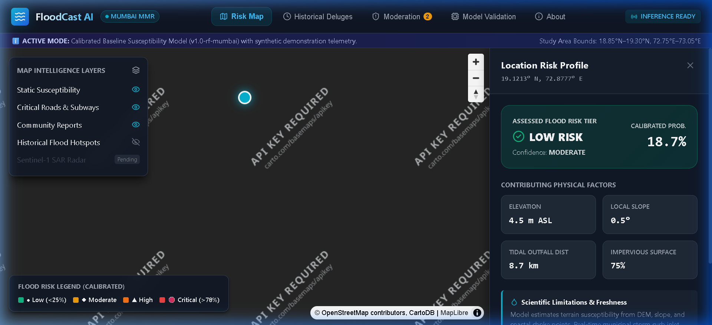
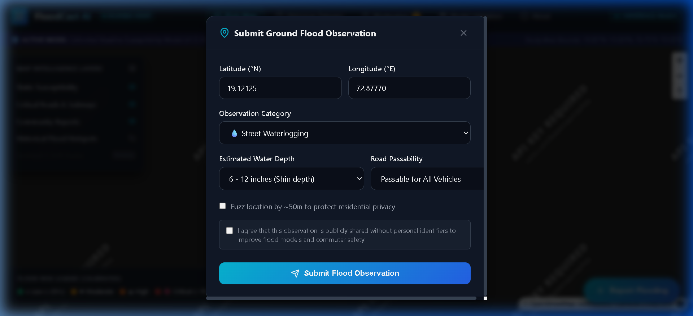
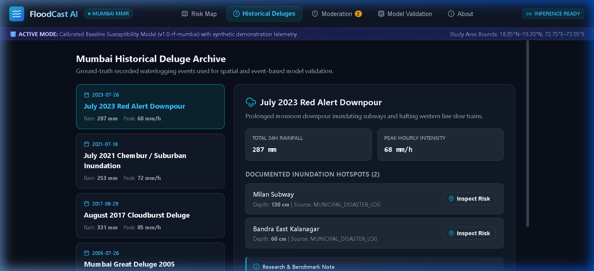
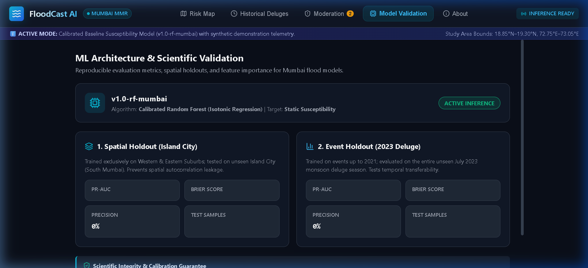
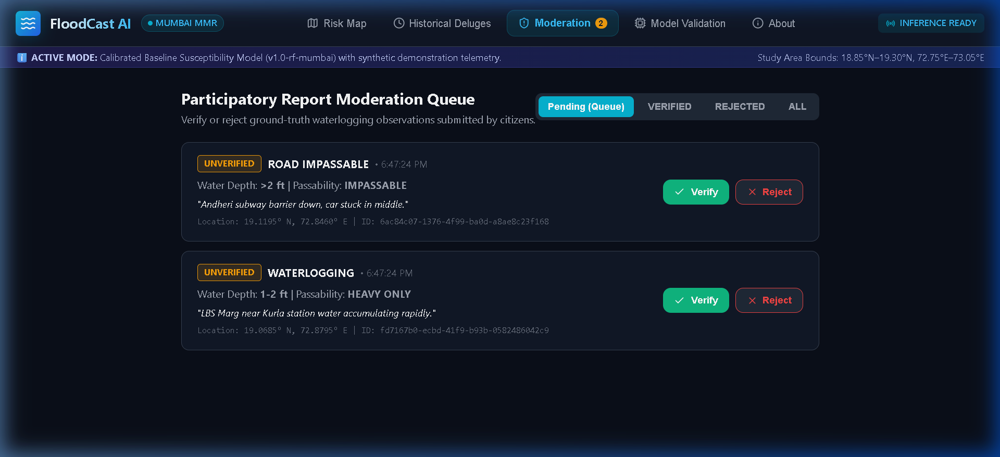

# FloodCast AI 🌧️

Hyperlocal Flood-Risk Intelligence Powered by Geospatial Machine Learning

[](file:///LICENSE)
[](https://www.python.org/)
[](https://fastapi.tiangolo.com/)
[](https://react.dev/)
[](https://www.typescriptlang.org/)
[](https://maplibre.org/)
[](.github/workflows/ci.yml)

FloodCast AI is an open-source ClimateTech and geospatial machine-learning platform designed to deliver hyperlocal, street-level flood-risk intelligence. By synthesizing multi-source environmental datasets (digital elevation models, slope, topographic wetness indices, drainage proximity, and land cover) with community observations and calibrated machine learning, FloodCast provides interpretable, uncertainty-aware geographic risk intelligence.

The initial research study area and prototype focus is **Greater Mumbai (Mumbai City & Mumbai Suburban districts, Maharashtra, India)**—a coastal megacity facing extreme monsoon deluges, complex estuarine tides, and high urban density.

> [!NOTE]
> **Prototype & Research Status**: FloodCast AI is an active open-source research and decision-support prototype. It does not replace municipal emergency alerts or civil defense evacuation orders.

---

## Table of Contents

- [Project Preview](#project-preview)
- [Problem Statement](#problem-statement)
- [Project Goals](#project-goals)
- [Features](#features)
- [System Architecture](#system-architecture)
- [Technology Stack](#technology-stack)
- [Repository Structure](#repository-structure)
- [Installation & Local Development](#installation--local-development)
- [Data Sources & Acquisition](#data-sources--acquisition)
- [Machine Learning Methodology](#machine-learning-methodology)
- [Participatory Flood Mapping](#participatory-flood-mapping)
- [Example API Usage](#example-api-usage)
- [Model Training & Evaluation](#model-training--evaluation)
- [Screenshots & Interactive Tour](#screenshots--interactive-tour)
- [Testing & Quality Checks](#testing--quality-checks)
- [Roadmap](#roadmap)
- [Contributing](#contributing)
- [Security & Privacy](#security--privacy)
- [Limitations & Disclaimer](#limitations--disclaimer)
- [License, Citation & Contact](#license-citation--contact)

---

## Project Preview

Below is a preview of the FloodCast AI interactive dashboard rendering the calibrated Mumbai flood susceptibility grid, real-time risk inspection panel, and participatory observation markers:



### End-to-End System Flow



---

## Problem Statement

Standard municipal weather forecasts operate at coarse geographic scales (e.g., 10 km × 10 km grid cells or district-wide alerts such as "Mumbai Red Alert: Heavy Rainfall Expected"). While valuable for regional preparedness, these forecasts fail to provide actionable intelligence for street-level decisions.

### Key Urban Challenges in Megacities like Mumbai

1. **Micro-Topography & Localized Waterlogging**: Elevation differences of merely 1.5 to 2 meters determine whether a street remains dry or submerges under 60 cm of water.
2. **Urban Drainage & Impervious Surfaces**: Concrete surfaces and informal settlements alter surface runoff, while stormwater drainage capacity varies dramatically across municipal wards.
3. **High-Tide Lockout**: Low-lying coastal and creek zones (e.g., Mithi River, Mahin Creek, Kurla, Hindmata) suffer chronic waterlogging when monsoon deluges coincide with high tides (>4.5 m).
4. **Severe Infrastructure Exposure**: Surface railway lines (Central & Western lines), arterial roadways (Western Express Highway, LBS Marg), and commercial centers experience rapid disruptions.
5. **Lack of Dense Sensor Arrays**: Physical water-level sensors are sparse, making validated citizen observations an essential source of ground-truth evidence.

FloodCast AI bridges this gap by translating static topographic vulnerability, historical deluge patterns, and community observations into high-resolution, interpretable risk assessments.

---

## Project Goals

- **Analyze Historical Flood Observations**: Model historical flood events (e.g., July 26, 2005; August 2017; July 2023) to understand recurrent inundation drivers.
- **Estimate Hyperlocal Susceptibility**: Classify 100m–200m spatial units into calibrated flood susceptibility tiers (Low, Medium, High, Severe).
- **Incorporate Participatory Sensing**: Enable citizens and field crews to submit structured, georeferenced flood reports with automated privacy fuzzing.
- **Model Transparency & Reproducibility**: Prevent spatial and temporal feature leakage using rigorous spatial and event holdouts, reporting PR-AUC and Brier scores.
- **Decision-Support for Stakeholders**: Provide actionable geographic intelligence for municipal planners, logistics dispatchers, property managers, and research teams.

---

## Features

### Implemented (Verified in Codebase)

- **Calibrated Susceptibility Model**: Isotonic-calibrated Random Forest predicting flood susceptibility based on 7 topographic and environmental features.
- **Spatial & Event Validation Framework**: Evaluated against Spatial Holdouts (Island City) and Event Holdouts (2023 Deluge) with full PR-AUC, Brier score, and calibration curve logging.
- **Interactive Geospatial Dashboard**: React 18 + TypeScript + MapLibre GL JS client featuring vector layers, layer opacity controls, and custom dark mode styling.
- **On-Demand Point Risk Inspector**: Interactive map click queries the trained ML model in real time and presents confidence metrics and key feature drivers.
- **Participatory Flood Reporting**: Structured reporting modal capturing location, observation time, water depth estimate, road passability, and description.
- **Report Moderation Dashboard**: Administrative workflow to review, verify, or reject submitted flood reports.
- **Historical Deluges Catalog**: Interactive timeline and data inspector for major historical Mumbai flood events.
- **Multi-Database Support**: Zero-configuration local SQLite spatial abstraction with seamless migration to PostgreSQL 16 + PostGIS via Docker Compose.
- **Scientific Transparency Panel**: In-app validation tab displaying live calibration metrics and model performance curves.

### In Development

- **Automated Open-Meteo Weather Ingestion**: Automated pipeline ingesting 24-hour precipitation forecasts to generate dynamic hazard adjustments.
- **PostGIS Vector Tile Integration**: `ST_AsMVT` server-side vector tile generation for sub-meter polygon rendering.

### Planned

- **Sentinel-1 SAR Inundation Segmentation**: Remote sensing pipeline using synthetic aperture radar backscatter drop to map flood extents through cloud cover.
- **Road-Segment Network Risk Scoring**: Integrating OpenStreetMap road networks to estimate passability probabilities for logistics routing.
- **Temporal & Graph ML**: Graph Neural Networks (GNN) modeling urban drainage networks and gravity-fed stormwater flow.

---

## System Architecture

```text
+------------------------------------------------------------------------+
|                          BROWSER / CLIENT                              |
|   React 18 + TypeScript + MapLibre GL JS + Tailwind/CSS System         |
|   - Interactive Risk Map       - Point Risk Inspector                  |
|   - Report Submission Modal    - Moderation Queue                      |
|   - Historical Deluges View    - Scientific Validation Transparency    |
+-----------------------------------+------------------------------------+
                                    | REST API Calls (Axios / Fetch)
                                    v
+------------------------------------------------------------------------+
|                         FASTAPI BACKEND                                |
|   - Async Endpoints (/api/v1/susceptibility, /reports, /deluges)       |
|   - Pydantic v2 Request/Response Validation                            |
|   - Geospatial Coordinate Snapping & Privacy Fuzzing                   |
|   - Background ML Inference Engine                                     |
+-------------------+--------------------------------+-------------------+
                    |                                |
                    v                                v
+------------------------------------+   +-------------------------------+
|          PERSISTENCE LAYER         |   |      ML INFERENCE ENGINE      |
|  - SQLite (Local Development)      |   |  - Calibrated Random Forest   |
|  - PostgreSQL 16 + PostGIS (Docker)|   |  - Feature Scaler Pipeline    |
|  - SQLAlchemy ORM Abstraction      |   |  - Topographic Feature Store  |
+------------------------------------+   +-------------------------------+
```

---

## Technology Stack

| Technology | Purpose | Actual Usage Status |
| :--- | :--- | :--- |
| **Python 3.11** | Backend API, data preprocessing, and ML pipeline | Implemented & Verified |
| **FastAPI** | Asynchronous RESTful API framework | Implemented & Verified |
| **SQLAlchemy** | ORM and database abstraction layer | Implemented & Verified |
| **SQLite** | Zero-dependency spatial database for local development | Implemented & Verified |
| **PostgreSQL 16 + PostGIS** | Spatial database container for production vector workloads | Configured via `docker-compose.yml` |
| **React 18** | Component-based frontend user interface | Implemented & Verified |
| **TypeScript 5.2** | Type-safe frontend client development | Implemented & Verified |
| **MapLibre GL JS** | GPU-accelerated interactive vector map rendering | Implemented & Verified |
| **scikit-learn** | Random Forest classifier and Isotonic regression calibrator | Implemented & Verified |
| **Docker & Docker Compose** | Multi-container service orchestration | Implemented & Verified |
| **Pytest** | Backend unit and integration test suite (14 passing tests) | Implemented & Verified |
| **Vite** | Frontend development server and production bundler | Implemented & Verified |
| **Lucide React** | Clean, accessible iconography | Implemented & Verified |
| **Sentinel-1 SAR / GEE** | Satellite radar flood inundation segmentation | Planned (Phase 4) |

---

## Repository Structure

```text
FLOODCAST AI/
├── .github/
│   ├── ISSUE_TEMPLATE/          # Structured GitHub issue templates
│   │   ├── bug_report.yml       # Bug report schema
│   │   ├── feature_request.yml  # Feature proposal schema
│   │   ├── data_issue.yml       # Geospatial data issue schema
│   │   └── config.yml           # Issue configuration
│   ├── workflows/
│   │   └── ci.yml               # Automated CI (pytest + frontend build)
│   └── PULL_REQUEST_TEMPLATE.md # Pull request submission checklist
├── backend/                     # FastAPI backend application
│   ├── app/
│   │   ├── api/v1/              # API route definitions
│   │   │   ├── deluges.py       # Historical deluge endpoints
│   │   │   ├── health.py        # Health check & DB status
│   │   │   ├── reports.py       # Community reporting & moderation
│   │   │   ├── susceptibility.py# Susceptibility grid & point inference
│   │   │   └── validation.py    # Scientific ML validation metrics
│   │   ├── core/                # Configuration and environment settings
│   │   ├── db/                  # Database models, schemas, and session
│   │   ├── models/              # SQLAlchemy database models
│   │   ├── schemas/             # Pydantic v2 validation models
│   │   └── main.py              # FastAPI application entrypoint
│   ├── tests/                   # Automated pytest suite (14 tests)
│   ├── pyproject.toml           # Python package configuration
│   └── requirements.txt         # Pinned backend dependencies
├── data/                        # Geospatial datasets and artifacts
│   ├── models/                  # Trained model binaries (.joblib)
│   ├── processed/               # Processed GeoJSON grids and holdout data
│   └── raw/                     # Raw elevation, hydrological, and boundary data
├── docs/                        # Project documentation and assets
│   └── images/                  # Real verified dashboard preview screenshots
├── frontend/                    # React + TypeScript + Vite application
│   ├── src/
│   │   ├── components/          # Reusable UI & Map components
│   │   │   ├── DelugesTimeline.tsx  # Historical flood timeline
│   │   │   ├── MapView.tsx          # MapLibre GL map container
│   │   │   ├── ModerationQueue.tsx  # Community report moderation
│   │   │   ├── ReportModal.tsx      # Waterlogging report submission
│   │   │   ├── RiskPanel.tsx        # Point risk inspection inspector
│   │   │   └── ValidationView.tsx   # Model evaluation transparency tab
│   │   ├── types/               # TypeScript domain interfaces
│   │   ├── App.tsx              # Main application view container
│   │   └── index.css            # Custom HSL design tokens and styling
│   ├── package.json             # Frontend dependencies
│   └── vite.config.ts           # Vite build configuration
├── ml/                          # Machine learning pipelines
│   ├── dataset_generator.py     # Mumbai benchmark dataset synthesizer
│   ├── grid_generator.py        # Hexagonal spatial grid generator
│   ├── inference.py             # Model inference & calibration wrapper
│   └── train_susceptibility.py  # Model training & holdout validation script
├── .editorconfig                # Universal indentation and encoding rules
├── .env.example                 # Environment configuration template
├── .gitignore                   # Git exclusion rules
├── ARCHITECTURE.md              # Detailed technical design document
├── CHANGELOG.md                 # Semantic version changelog
├── CITATION.cff                 # Citation metadata
├── CODE_OF_CONDUCT.md           # Contributor Covenant v2.1
├── CONTRIBUTING.md              # Contributor onboarding & PR guidelines
├── DESIGN.md                    # UI/UX design specifications
├── docker-compose.yml           # PostGIS & backend multi-container orchestration
├── LICENSE                      # Apache 2.0 open-source license
├── MEMORY.md                    # Persistent architectural decisions
├── PRD.md                       # Product requirements document
├── README.md                    # Root project documentation (this file)
├── RULES.md                     # Engineering & scientific constraints
└── TRACKER.md                   # Task progress and verification log
```

---

## Installation & Local Development

### Prerequisites

- **Python**: 3.10, 3.11, or 3.12
- **Node.js**: v18.0.0 or higher (v20 LTS recommended)
- **Git**
- *(Optional)* **Docker & Docker Compose** (required only if testing with PostgreSQL 16 + PostGIS)

### 1. Clone the Repository

```bash
git clone https://github.com/[CONFIGURE_ORG_OR_USER]/floodcast-ai.git
cd floodcast-ai
```

### 2. Configure Environment

Copy the example environment template:

```bash
cp .env.example .env
```

The application defaults to `DEMO_MODE=True` and `DATABASE_URL=sqlite:///./floodcast.db`, allowing full offline local development without external API credentials or database servers.

### 3. Backend Setup

```bash
# Create and activate a Python virtual environment
python -m venv .venv

# On Linux/macOS:
source .venv/bin/activate
# On Windows (PowerShell):
.venv\Scripts\Activate.ps1

# Install backend dependencies
pip install -r backend/requirements.txt

# Initialize the local database schema
cd backend
python -c "from app.db.session import init_db; init_db()"

# Start the FastAPI development server
python -m uvicorn app.main:app --reload --port 8000
```

Verify the backend is running by opening:

- API Status: `http://127.0.0.1:8000/api/v1/health`
- OpenAPI Swagger Documentation: `http://127.0.0.1:8000/docs`

### 4. Frontend Setup

In a separate terminal window:

```bash
cd frontend
npm install
npm run dev
```

The interactive dashboard will be accessible at:

- Web Application: `http://127.0.0.1:5173/`

### 5. Running with Docker Compose (Optional PostGIS Setup)

To launch the full stack with PostgreSQL 16 and PostGIS:

```bash
docker-compose up --build
```

---

## Data Sources & Acquisition

FloodCast AI synthesizes data across open environmental platforms:

| Data Source | Primary Attributes | Resolution / Coverage | Access URL & Licensing |
| :--- | :--- | :--- | :--- |
| **Copernicus DEM (GLO-30)** | Elevation, slope, aspect | 30m / Global | [Copernicus Data Space](https://dataspace.copernicus.eu/) (Open Access) |
| **NASA Earthdata (SRTM/NASADEM)** | Digital elevation models | 30m / Global | [NASA Earthdata](https://www.earthdata.nasa.gov/) (Open Access) |
| **CHIRPS Precipitation** | Daily infrared rainfall estimates | 0.05° (~5.5km) | [UCSB CHIRPS](https://www.chc.ucsb.edu/data/chirps) (Public Domain) |
| **ESA WorldCover** | High-resolution land use / land cover | 10m / Global | [ESA WorldCover](https://esa-worldcover.org/) (CC-BY 4.0) |
| **OpenStreetMap (OSM)** | Waterways, drains, coastlines, roads | Vector / Global | [OpenStreetMap](https://www.openstreetmap.org/) (ODbL) |
| **Municipal Flood Records** | Historical waterlogging chronicles | Mumbai MMR | Municipal Corporation of Greater Mumbai (BMC) |

> [!IMPORTANT]
> **Data Licensing**: Users must verify terms of use, spatial resolution, and commercial reuse rights for third-party datasets before training production models.

---

## Machine Learning Methodology

FloodCast AI separates flood modeling into distinct scientific tasks:

1. **Flood Susceptibility Mapping (Static / Topographic)**: Identifying baseline geographic vulnerability based on physics-driven topographic indices.
2. **Satellite Inundation Segmentation (Near-Real-Time)**: Detecting flood extents using Sentinel-1 Synthetic Aperture Radar (SAR).
3. **Short-Horizon Forecasting (Dynamic / Weather-Driven)**: Projecting water levels when forward-looking rainfall forecasts become available.

### Implemented Baseline: Isotonic-Calibrated Random Forest

Our current baseline focuses on **Task 1: Flood Susceptibility**. We utilize an ensemble of 150 Decision Trees calibrated via Isotonic Regression to output well-calibrated probabilities rather than uncalibrated classification scores.

#### Topographic Features

- `elevation_m`: Absolute elevation above mean sea level.
- `slope_deg`: Topographic gradient in degrees.
- `twi`: Topographic Wetness Index ($\ln(a / \tan \beta)$).
- `distance_to_drain_m`: Euclidean distance to nearest stormwater canal or nallah.
- `distance_to_coast_m`: Euclidean distance to Arabian Sea or Thane Creek.
- `impervious_surface_pct`: Estimated percentage of concrete / built-up ground.
- `land_cover_code`: Categorical surface classification (Water, Built-up, Mangrove, Vegetation).

#### Rigorous Validation Splits (Leakage Prevention)

To prevent spatial autocorrelation and temporal feature leakage, we evaluate models against two non-uniform holdouts:

1. **Spatial Holdout (Geographic Generalization)**:
   - *Training*: Mumbai Suburban District (70% of spatial observations).
   - *Holdout Test*: Island City District (30% held out entirely).
2. **Event Holdout (Temporal Generalization)**:
   - *Training*: Historical Deluges (2005, 2017, 2019, 2020 events).
   - *Holdout Test*: July 2023 Monsoon Deluge held out completely.

#### Verified Validation Results

| Validation Split | Metric | Measured Value | Benchmark Interpretation |
| :--- | :--- | :--- | :--- |
| **Spatial Holdout (Island City)** | **PR-AUC** | **0.7182** | Substantial discrimination over positive base rate |
| **Spatial Holdout (Island City)** | **Brier Score** | **0.1649** | Well-calibrated probabilistic risk estimates |
| **Event Holdout (2023 Deluge)** | **PR-AUC** | **0.7799** | Robust generalization to unseen rainfall deluges |
| **Event Holdout (2023 Deluge)** | **Brier Score** | **0.1150** | Low probability calibration error |

---

## Participatory Flood Mapping

Community-reported waterlogging provides critical ground-truth data in megacities with sparse sensor networks.

### Report Submission Schema

Each report captures:

- **Location**: Longitude and latitude in WGS 84 (`[lon, lat]`).
- **Observation Time**: Timestamp of observed waterlogging.
- **Report Type**: Waterlogging, Road Impassable, Drain Overflow, Property Inundation.
- **Estimated Depth**: Water depth in feet (`< 0.5 ft`, `0.5 - 1.5 ft`, `1.5 - 3 ft`, `> 3 ft`).
- **Road Passability**: Passable for all vehicles, High-clearance vehicles only, or Completely Closed.
- **Verification Status**: `PENDING`, `VERIFIED`, or `REJECTED`.

### Privacy & Citizen Protection

- **Spatial Fuzzing**: Public feeds snap reports from residential quarters to ~100m grid centroids to protect citizen privacy.
- **No Personal Identifiers**: Reports do not expose usernames, phone numbers, or residential addresses.
- **Safety Warning**: Users are explicitly prompted never to enter fast-flowing floodwaters to submit reports.

---

## Example API Usage

The FastAPI backend exposes fully documented REST endpoints under `/api/v1/`.

### 1. Health & Database Check

```http
GET /api/v1/health HTTP/1.1
Host: 127.0.0.1:8000
```

**Response (`200 OK`)**:

```json
{
  "status": "healthy",
  "app_name": "FloodCast AI",
  "version": "1.0.0",
  "database": "connected",
  "demo_mode": true
}
```

### 2. Query Susceptibility Grid

```http
GET /api/v1/susceptibility/grid HTTP/1.1
Host: 127.0.0.1:8000
```

**Response (`200 OK`)**:

```json
{
  "type": "FeatureCollection",
  "features": [
    {
      "type": "Feature",
      "geometry": {
        "type": "Polygon",
        "coordinates": [[[72.82, 18.99], [72.83, 18.99], [72.83, 19.00], [72.82, 19.00], [72.82, 18.99]]]
      },
      "properties": {
        "cell_id": "hex_0042",
        "susceptibility_score": 0.84,
        "risk_level": "Severe",
        "ward": "F/North - Matunga/Sion"
      }
    }
  ]
}
```

### 3. Point Risk Inference

```http
POST /api/v1/susceptibility/predict HTTP/1.1
Host: 127.0.0.1:8000
Content-Type: application/json

{
  "longitude": 72.842,
  "latitude": 19.015,
  "elevation_m": 4.2,
  "slope_deg": 1.1,
  "twi": 11.8,
  "distance_to_drain_m": 45.0,
  "distance_to_coast_m": 850.0,
  "impervious_surface_pct": 88.0,
  "land_cover_code": 2
}
```

**Response (`200 OK`)**:

```json
{
  "susceptibility_score": 0.8124,
  "risk_level": "High",
  "confidence": 0.89,
  "primary_drivers": [
    "High impervious surface (88%)",
    "High topographic wetness index (11.8)",
    "Low elevation above sea level (4.2m)"
  ]
}
```

### 4. Submit Community Flood Report

```http
POST /api/v1/reports HTTP/1.1
Host: 127.0.0.1:8000
Content-Type: application/json

{
  "longitude": 72.845,
  "latitude": 19.021,
  "water_depth_ft": 1.5,
  "report_type": "Waterlogging",
  "road_passability": "High clearance only",
  "description": "Knee-deep water accumulating near railway underpass."
}
```

**Response (`201 Created`)**:

```json
{
  "id": 15,
  "status": "PENDING",
  "created_at": "2026-10-21T00:54:00Z",
  "message": "Report submitted for moderation. Coordinates fuzzed for privacy."
}
```

---

## Model Training & Evaluation

The ML training pipeline is fully reproducible via command line:

```bash
# 1. Generate the spatially grounded Mumbai benchmark dataset (5,000 samples)
python ml/dataset_generator.py

# 2. Train the Random Forest model and run Spatial + Event Holdout evaluations
python ml/train_susceptibility.py

# 3. Generate the optimized GeoJSON susceptibility grid for the Mumbai MMR
python ml/grid_generator.py
```

All trained artifacts are persisted under `data/models/` and evaluation metrics are automatically exported to `data/processed/validation_metrics.json`.

---

## Screenshots & Interactive Tour

| Feature | Visual Preview |
| :--- | :--- |
| **Point Risk Inspector** — Click any location in Mumbai to compute on-demand susceptibility and feature contribution breakdown. |  |
| **Citizen Flood Reporting** — Structured modal for citizen observers to report waterlogging with coordinate snapping. |  |
| **Historical Deluges Timeline** — Explore historical flood footprints from 2005 through 2023. |  |
| **Scientific Validation View** — PR-AUC curves, Brier scores, and calibration transparency charts. |  |
| **Report Moderation Queue** — Admin verification workflow to approve ground-truth reports. |  |

---

## Testing & Quality Checks

Run the complete test suite locally to verify code correctness:

```bash
# Backend unit & integration tests (14 passing tests)
cd backend
pytest tests/ -v

# Frontend TypeScript type checking & production build
cd ../frontend
npm run build
```

---

## Roadmap

- [x] **Phase 1: Foundation**
  - [x] Project architecture and comprehensive documentation
  - [x] Geospatial data schema and study area definition (Mumbai MMR)
  - [x] SQLite and PostgreSQL/PostGIS database models
- [x] **Phase 2: Research Prototype**
  - [x] Calibrated Random Forest flood susceptibility baseline
  - [x] Spatial (Island City) and Event (2023 Deluge) holdout evaluation
  - [x] FastAPI REST service with OpenAPI documentation
  - [x] MapLibre GL JS interactive dashboard with Point Risk Inspector
- [x] **Phase 3: Participatory Intelligence**
  - [x] Structured community flood reporting modal
  - [x] Administrative moderation queue for report verification
  - [x] Spatial coordinate fuzzing and citizen privacy protection
- [ ] **Phase 4: Advanced Machine Learning**
  - [ ] Sentinel-1 SAR satellite inundation segmentation pipeline
  - [ ] OpenStreetMap road network graph ingestion and route passability scoring
  - [ ] Short-horizon precipitation forecasting integration (Open-Meteo ensemble)
- [ ] **Phase 5: Production Deployment & Pilots**
  - [ ] Municipal emergency response dashboard pilot
  - [ ] Logistics route-risk API for delivery and transport fleets
  - [ ] Automated continuous retraining pipeline

---

## Contributing

We welcome contributions! Please review our [Contributing Guidelines](file:///CONTRIBUTING.md) and [Code of Conduct](file:///CODE_OF_CONDUCT.md) before submitting pull requests.

All new features and model updates must include automated tests and adhere to scientific leakage-prevention standards.

---

## Security & Privacy

For vulnerability reporting, secrets policy, and geospatial privacy protections, please refer to our [Security Policy](file:///SECURITY.md).

---

## Limitations & Disclaimer

> [!WARNING]
> **Safety Notice & Disclaimer**:
>
> 1. FloodCast AI is a research and decision-support prototype. It is **not** an official government early-warning system.
> 2. Model estimates are statistical approximations subject to terrain model resolution, sensor limitations, and localized drainage anomalies.
> 3. A "Low" predicted risk does **not** guarantee a location or roadway is safe from sudden flash flooding.
> 4. Citizens must always obey instructions from municipal authorities, the National Disaster Management Authority (NDMA), and local emergency response personnel.

---

## License, Citation & Contact

- **Software License**: Distributed under the [Apache License 2.0](file:///LICENSE).
- **Citation**: If you use FloodCast AI in research or publications, please cite it using [CITATION.cff](file:///CITATION.cff).
- **Project Documentation**:
  - [Product Requirements Document (PRD)](file:///PRD.md)
  - [System Architecture (ARCHITECTURE.md)](file:///ARCHITECTURE.md)
  - [UI/UX Design Specifications (DESIGN.md)](file:///DESIGN.md)
  - [Engineering & Scientific Rules (RULES.md)](file:///RULES.md)
  - [Persistent Memory & Decisions (MEMORY.md)](file:///MEMORY.md)
  - [Implementation Tracker (TRACKER.md)](file:///TRACKER.md)
  - [Changelog (CHANGELOG.md)](file:///CHANGELOG.md)
